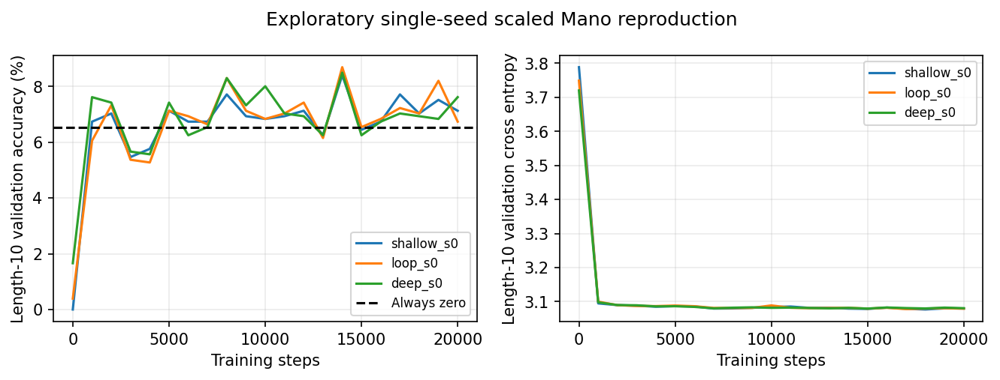
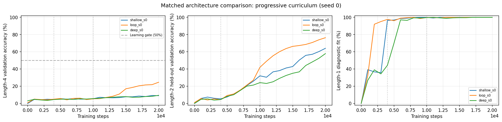
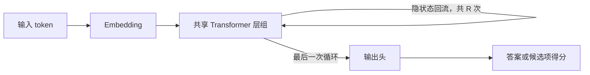

<div align="center">

# Ouro · Minimal Reproduction

**Scaling Latent Reasoning via Looped Language Models**<br>
在一张 V100 上，验证循环深度的收益，并尝试从头训练一个最小对照。

[](https://arxiv.org/abs/2510.25741v6)
[](#quickstart)
[](requirements.txt)
[](#resources)

[实验结果](#results) · [追加诊断](#recovery) · [方法与对照](#method) · [快速复现](#quickstart) · [实验记录](#evidence) · [结论边界](#limitations)

</div>

---

> **当前结论**：公开权重的循环深度趋势已复现。首轮小模型学习不足；追加 11 组训练后，在缩小的四次运算任务上观察到循环模型 **24.66%**、浅层 **9.08%**、深层 **9.47%** 的单种子差异。完整论文训练结论仍未复现，以下保留各阶段证据与局限。

这是论文的**独立、非官方最小复现**，包含两条实验线：

| 实验线 | 核心问题 | 本轮结果 |
|---|---|---|
| **公开权重验证** | 同一 Ouro-1.4B 检查点，增加循环次数是否改善表现？ | 两项完整基准均重现先升后降的深度趋势 |
| **小模型训练对照** | 共享权重循环，是否优于同参数量或同展开深度模型？ | 追加诊断恢复短组合学习，出现单种子收益迹象；尚未通过确认阶段门 |

<a id="results"></a>

## 01 · 实验结果

### 公开权重：四次循环达到最高实测分数

使用 `ByteDance/Ouro-1.4B` **Base**，评估 1、2、3、4、6、8 次循环。下表单位为百分比；论文数值来自 Table 10。

| 循环次数 | ARC · 本地 | ARC · 论文 | Winogrande · 本地 | Winogrande · 论文 |
|:---:|---:|---:|---:|---:|
| 1 | 38.48 | 37.63 | 56.35 | 56.99 |
| 2 | 54.95 | 54.86 | 66.38 | 66.69 |
| 3 | 59.73 | 59.47 | 69.53 | 71.35 |
| **4** | **60.15** | **60.92** | **70.96** | **72.30** |
| 6 | 58.45 | 59.73 | 69.69 | 71.03 |
| 8 | 57.94 | 58.19 | 68.35 | 69.30 |


**12 个测量点与论文的差异均不超过 1.82 个百分点。** 四次相对一次循环，ARC 提升 **21.67** 个百分点，Winogrande 提升 **14.60** 个百分点；继续增加到八次则出现下降。

| 配对差值 | ARC · 差值与 95% 区间 | Winogrande · 差值与 95% 区间 |
|---|---:|---:|
| R4 − R1 | +21.67 [18.86, 24.66] | +14.60 [11.37, 17.84] |
| R4 − R3 | +0.43 [−0.68, 1.62] | +1.42 [−0.16, 3.00] |
| R8 − R4 | −2.22 [−3.58, −0.85] | −2.60 [−4.42, −0.79] |

区间由逐题配对 bootstrap 得到，重采样 10,000 次。**四次的点估计最高，但尚不能断言四次显著优于三次。** 区间描述题目采样的不确定性，未经多重比较校正，也不代表训练种子间的方差。

[完整审查](experiments/ouro-20261026-depth-full/review.md) · [机器可读指标](experiments/ouro-20261026-depth-full/depth-report.json) · [配对统计](experiments/ouro-20261026-depth-full/paired-comparisons.json) · [矢量图 SVG](experiments/ouro-20261026-depth-full/depth-curves.svg)

### 首轮小模型：对照完成，学习信号不足

在模 23 的前缀算术任务 Mano 上，三组模型均从头训练 **20,000 步**，各消耗相同的 **81,929,878 个非填充 token**、**5,120,000 道表达式**。以下为固定训练终点的长度 10 验证准确率，未挑选曲线中的最高点。

| 模型 | 结构 | 参数量 | 验证准确率 | 对照目的 |
|---|:---:|---:|---:|---|
| Shallow | 3 层 × 1 次 | 2.38M | 7.13% | 同参数量基线 |
| Loop | 3 层 × 4 次 | 2.38M | 6.74% | 共享权重循环 |
| Deep | 12 层 × 1 次 | 9.49M | 7.62% | 同展开计算深度基线 |
| Always zero | 始终预测 0 | — | 6.54% | 答案分布基线 |



三组曲线均接近基线，短表达式诊断也显示基本算术学习不足。因此，本轮**未建立循环结构的训练优势**；这也不能用于否定论文。当前结果仅为单种子探索，未追加多种子确认，预留的 10,000 道测试题未评分。

[训练审查与局限](experiments/ouro-20261026-mano-extended/review.md) · [代码及配置审计](experiments/ouro-20261026-mano-extended/provenance-audit.json) · [矢量图 SVG](experiments/ouro-20261026-mano-extended/training-curves.svg)

<a id="recovery"></a>

### 追加诊断：从基本运算拟合，推进到组合学习

新增 **11 组正式训练**，按三个阶段检查首轮失败原因：

| 阶段 | 对照 | 观察与决定 |
|---|---|---|
| 单步学习 | 2 档学习率 × FP16/FP32 | 四组均能拟合训练集到 100%；没有证据把失败简单归因于 FP16 |
| 长度 10 数据对照 | 原树分布/官方式分布 × 有无单步预热 | 主验证准确率仍为 6.74%–7.91%，未通过有效学习门槛 |
| 缩小的组合任务 | 浅层/循环/深层，统一渐进课程 | 三组都恢复短组合学习，循环模型在此单种子设置中表现更好 |

还确认了一个分布偏差：原始 Mano 作者代码均匀采样左右子树的运算数划分，首轮代码均匀采样完整树形状。10 次运算时平均树高分别为 **5.64** 和 **7.07**。现在已增加 `uniform_split` 选项，并保留原默认数据流用于历史重放；修正分布本身尚不足以恢复长度 10 的学习。

新的机制试验将任务缩为最多 **4 次运算**，三组均训练 20,000 步，采用相同的“单步 → 最多两步 → 最多四步”课程和数据流。

| 模型 | 参数量 | 两步保留验证集 | 四步主验证集 |
|---|---:|---:|---:|
| Shallow · 3 层 × 1 次 | 2.38M | 64.06% | 9.08% |
| **Loop · 3 层 × 4 次** | **2.38M** | **76.37%** | **24.66%** |
| Deep · 12 层 × 1 次 | 9.49M | 57.91% | 9.47% |
| 始终答 0 | — | 7.03% | 6.59% |



三个检查点的六项 L2/L4 分数均通过独立复算。四步任务上，循环模型相对浅层和深层分别提升 **15.58**、**15.19** 个百分点；答案非零的题目上准确率为 **22.58%**，改善并非仅靠多预测零。

**这仍是探索性结果。** 任务难度与原论文不同，只有一个种子，超参数不保证对每种架构分别最优。循环模型未达到预设的 50% 有效学习门槛，因此没有追加多种子确认，长度 10 和长度 4 的预留测试集都未评分。曲线支持继续研究训练预算与组合学习，不支持宣称完整复现成功。

[失败分析与完整审查](experiments/ouro-20261026-recovery/review.md) · [单步对照](experiments/ouro-20261026-recovery/atomic-review.md) · [数据对照](experiments/ouro-20261026-recovery/data-review.md) · [逐题复算及配对区间](experiments/ouro-20261026-recovery/composition-verification.json) · [版本审计](experiments/ouro-20261026-recovery/composition-source-audit.json)

<details>
<summary><strong>重放追加诊断与组合试验</strong></summary>

仅运行这些合成任务时，可跳过公开权重与 ARC/Winogrande 数据下载。安装环境后，在干净工作区中按阶段运行、检查报告，再进入下一阶段；输出目录应是新目录。

```bash
python -m scripts.run_matrix --config configs/atomic_matrix.json
python -m scripts.run_matrix --config configs/recovery_data_matrix.json
python -m scripts.run_matrix --config configs/composition_matrix.json

python scripts/report_recovery.py \
  --atomic-directory runtime/atomic-probe \
  --data-directory runtime/recovery-data \
  --architecture-directory runtime/composition-s0 \
  --output runtime/recovery-analysis

python -m scripts.verify_composition \
  --directory runtime/composition-s0 \
  --output runtime/composition-verification
```

11 组正式训练报告记录的训练/评估耗时合计约 **62.6 分钟**，不含准备、CPU 检查、GPU 冒烟与独立重新评分。任务书中的预算上限、原始运行提交和阶段决定均保留在 `experiments/ouro-20261026-recovery/`。

</details>

<a id="method"></a>

## 02 · 方法与对照

本节描述首轮协议；追加诊断的树分布、课程和更小的任务难度见[追加诊断](#recovery)，两轮结果分别解释。

循环模型在隐状态中重复应用同一组 Transformer 参数，让一个 token 在输出前经历更多计算。



### 公开权重评估协议

| 项目 | ARC-Challenge | Winogrande |
|---|---|---|
| 数据划分 | Test，1,172 题 | 有标签 Validation，1,267 题 |
| Few-shot | 25-shot | 5-shot |
| 指标 | `acc_norm` | `acc` |
| 提示与采样 | 标准 lm-eval 模板，few-shot seed = 1234 | 标准 lm-eval 模板，few-shot seed = 1234 |

不使用 chat template，不截断提示。模型以 FP16 计算，候选项的 log-softmax 使用 FP32。

完整扫描复用一次八循环前向中的中间状态，得到六个深度的分数。进入正式评估前，每个深度均与独立截断的 HFLM 前向核对：8 个校准候选请求的似然差为 0；另外 32 道 ARC 小样本的 R4 正确性记录也完全一致。

独立深度评分器同时设置 config 与 model 的 `total_ut_steps`，明确指定从零开始的最终退出位置，并通过 hook 检查实际循环次数。**完整扫描的总耗时不能解释为各深度的独立延迟，也没有验证动态提前退出的加速效果。**

### 小模型训练协议

统一使用宽度 256、4 个注意力头、MLP 宽度 1024、RoPE、GPT 风格 pre-norm/GELU，以及绑定的输入与输出嵌入。训练长度均匀采样 1–10 次运算；验证只使用最难的长度 10。表达式以 Catalan 计数均匀采样二叉树形状，运算符为 `+`、`−`、`×`，数值属于 F₂₃。

每道表达式独占一行，不进行样本拼接；输入中不含答案，只监督最终单 token 答案。三组共享数据流及保留集，采用相同的优化器、批量和训练日程。每组先进行两档学习率的 2,000 步 pilot，再依据验证交叉熵选择 `2e-4`，从头完成 20,000 步扩展。

<a id="quickstart"></a>

## 03 · 快速复现

以下命令从仓库根目录执行。运行 GPU 实验前保持 Git 工作区干净；修改代码或配置后先提交。各实验输出目录必须是新目录，GPU 任务按顺序执行。

### 1. 安装环境

准备 Python 3.10、Git、curl 和可用的 NVIDIA CUDA 环境。下面的安装命令对应本轮使用的 PyTorch CUDA 12.1 构建；`requirements.txt` 不重复安装 PyTorch。

```bash
git clone https://github.com/Flutter-Misdreavus/ouro-minimal-reproduction.git
cd ouro-minimal-reproduction

python3.10 -m venv .venv
source .venv/bin/activate
python -m pip install torch==2.2.2 --index-url https://download.pytorch.org/whl/cu121
python -m pip install -r requirements.txt

python -c "import torch; assert torch.cuda.is_available(); print(torch.cuda.get_device_name(0))"
```

<details>
<summary><strong>本轮环境与上游版本</strong></summary>

| 组件 | 实测版本 |
|---|---|
| Python | 3.10.14 |
| PyTorch / CUDA 构建 | 2.2.2 / 12.1 |
| Transformers | 4.55.4 |
| lm-evaluation-harness | 0.4.9.2 |
| datasets | 3.6.0 |
| GPU | Tesla V100-SXM2-32GB |
| 精度 | FP16；训练使用动态梯度缩放；似然 softmax 为 FP32 |

V100 没有原生 BF16 支持。本轮没有测量其他显卡的耗时或最小显存需求。

| 上游资源 | 实际 revision |
|---|---|
| `ByteDance/Ouro-1.4B` | `574fa66cb8bf5abdc979642d01cf2b79b16bfab1` |
| `allenai/ai2_arc` | `210d026faf9955653af8916fad021475a3f00453` |
| `allenai/winogrande` | `01e74176c63542e6b0bcb004dcdea22d94fb67b5` |

[完整环境清单](experiments/ouro-20261026-mano-extended/environment.json) · [上游版本清单](experiments/ouro-20261026-local-prep/upstream.json)

</details>

### 2. 准备公开权重与数据

`prepare_ouro.py` 会查询上游**运行时的当前 revision**，将其写入 `runtime/upstream.json`，随后按该 revision 下载文件。它并非硬编码本轮版本。下面先核对清单，再继续下载大文件；若核对失败，应先解决版本差异，不能将后续结果视为本轮检查点的重放。

```bash
python scripts/prepare_ouro.py

python - <<'PY'
import json
from pathlib import Path
expected = json.loads(Path('experiments/ouro-20261026-local-prep/upstream.json').read_text())
actual = json.loads(Path('runtime/upstream.json').read_text())
assert actual == expected, 'Upstream revisions changed; resolve the mismatch before replaying.'
print('Upstream revisions match the published run.')
PY

python scripts/download_weights.py
python scripts/prepare_data.py
```

模型权重通过上游 SHA256 校验，数据分片进行大小与哈希核验。模型、数据和下载缓存均保存在被 Git 忽略的 `runtime/` 中。

### 3. 先通过正确性与小样本检查

```bash
python -m pytest tests -q

# 小模型训练冒烟
python -m ouro_repro.train \
  --config configs/mano_smoke.json \
  --output runtime/mano-smoke

# 独立 R4 评分器：32 道 ARC 校准题
python -m ouro_repro.eval_ouro \
  --loops 4 --task arc_challenge --smoke --limit 32 \
  --output runtime/arc-smoke

# 共享中间状态评分器：六个深度的校准与小样本检查
python -m ouro_repro.sweep_ouro \
  --smoke --output runtime/shared-depth-smoke
```

本轮通过了算术标签、前向与梯度等价性、因果遮罩、样本隔离、保存加载，以及上游循环实现兼容性检查。小样本分数只用于校准，不作为正式基准成绩。

### 4. 运行两条实验线

**A · 公开权重完整扫描**

```bash
python -m scripts.run_matrix --config configs/depth_shared_full.json

python scripts/report_results.py \
  --depth-directory runtime/shared-depth-formal/full \
  --output runtime/depth-analysis
```

监督器按配置限制总墙钟时间为 8 小时。评估输出包含机器可读指标、逐题正确性记录，以及曲线所需的数据。

**B · 小模型 pilot 与三组扩展**

```bash
python scripts/run_pilots.py
```

检查 pilot 的损失、学习信号与资源占用后，再执行已冻结的扩展矩阵。下面的配置重放本轮单种子探索，并不保证能让小模型学会任务。

```bash
python -m scripts.run_matrix --config configs/mano_extended.json

python scripts/report_results.py \
  --training-directory runtime/mano-extended-r2 \
  --output runtime/training-analysis
```

扩展矩阵会依次运行 `shallow_s0`、`loop_s0`、`deep_s0`，总墙钟上限为 3 小时。输出目录已存在时，请使用新的输出配置并先提交，保留旧实验记录。

<a id="resources"></a>

### 本轮资源实测

| 阶段 | 耗时 | 峰值 CUDA allocated 显存 |
|---|---:|---:|
| 公开权重完整六深度扫描 | 约 55 分钟 | 约 3.34 GB |
| 三组 20,000 步训练扩展合计 | 约 40.5 分钟 | 各组约 0.29 / 0.86 / 0.96 GB |

训练耗时不含 pilot、诊断、下载和被取消的启动尝试。显存为 PyTorch 分配量，不是整卡占用或推荐容量；扫描耗时是复用计算后的总成本。

<a id="evidence"></a>

## 04 · 实验记录与可追溯性

```text
.
├── configs/                  # 固定实验配置与顺序执行矩阵
├── ouro_repro/
│   ├── mano.py               # 模 23 表达式生成器与独立算术 oracle
│   ├── model.py              # 共享层组的循环 Transformer
│   ├── train.py              # 训练、验证、版本与数据流记录
│   ├── eval_ouro.py           # 独立固定深度评分
│   └── sweep_ouro.py          # 共享中间状态的六深度扫描
├── scripts/                  # 下载、监督、统计、绘图及公开内容检查
├── tests/                    # 机制与上游兼容性检查
├── experiments/              # 已发布的脱敏指标、审查与图表
└── runtime/                  # 本地权重、数据、日志与检查点；不进入 Git
```

| 记录 | 内容 |
|---|---|
| [准备与实现审查](experiments/ouro-20261026-local-prep/implementation-review.md) | 数据生成、标签、因果性与梯度检查 |
| [训练 pilot](experiments/ouro-20261026-mano-pilot/review.md) | 六次 pilot 的结论及扩展决策 |
| [启动修正记录](experiments/ouro-20261026-mano-pilot/launch-correction.md) | 被取消的尝试与干净工作区检查修复 |
| [评分器验收](experiments/ouro-20261026-depth-smoke/review.md) | 独立评分与共享状态评分的数值对照 |
| [公开权重完整结果](experiments/ouro-20261026-depth-full/review.md) | 六深度指标、配对区间与解释 |
| [小模型完整结果](experiments/ouro-20261026-mano-extended/review.md) | 三组曲线、学习诊断与停止决策 |

<details>
<summary><strong>实际运行提交与版本审计</strong></summary>

| 运行 | 实际执行 commit |
|---|---|
| 公开权重完整扫描 | `2e0cf5f9307ece99519e734fed58f33d949b356b` |
| Shallow 扩展 | `53fddb301c96a870a008fd034c5671ec7f819911` |
| Loop 扩展 | `27635750e1750b5b53b68492857c91d43c2a8f69` |
| Deep 扩展 | `2ddb73ddcbc83be0c43b7c07764cedd20b41f156` |

运行期间有独立的评估与报告工作提交，因此各运行 SHA 不同。审计已核对三组训练所使用的 `train.py`、`model.py`、`mano.py` 内容完全一致，并验证配置、保留集和训练数据流哈希。

每个报告保留实际 `run_commit`；后续文档提交不替代原始运行版本。检查点哈希可用于本地核验，权重本身不公开上传。

</details>

本仓库公开原始实现、配置和脱敏证据。凭据、私有路径、原始数据、模型权重、环境目录、原始日志和论文 PDF 均不提交。发布前显式暂存目标文件，检查差异，并运行 `python scripts/check_public.py`；该脚本辅助筛查，不能替代人工审查。

<a id="limitations"></a>

## 05 · 结论边界

- **覆盖范围**：本轮验证一个公开 Base 检查点在两项基准上的深度趋势，并完成缩小版 Mano 对照；没有复现完整 7.7T-token 预训练、全套评测或 SOTA 对比。
- **统计解释**：四次相对一次的提升、八次相对四次的下降有配对区间支持；四次优于三次的证据仍不足。
- **训练机制**：小模型只使用最终答案交叉熵，没有复现自适应退出门或熵正则训练。单种子结果不能形成确认性的架构结论。
- **尺度差异**：论文 Mano 使用宽度 1024；最容易的长度 10 设置训练 80,000 步、采用打包上下文。本轮宽度 256、训练 20,000 步，token 预算约为其 1/128。
- **深度外推**：公开模型早期预训练使用过八次循环，之后切换为四次；不能把超过四次称为完全未见过的循环深度。
- **后续方向**：先在较简单的验证任务上建立可靠学习信号，再冻结新的长度 10 对照，完成多种子确认后使用预留测试集。

## 参考资料

- [Scaling Latent Reasoning via Looped Language Models · arXiv:2510.25741v6](https://arxiv.org/abs/2510.25741v6)，2026-10-11。
- [ByteDance / Ouro-1.4B](https://huggingface.co/ByteDance/Ouro-1.4B)，本轮使用的公开 Base 模型。
- [EleutherAI / lm-evaluation-harness](https://github.com/EleutherAI/lm-evaluation-harness)，标准提示模板与评估协议。

---

<div align="center">

**让每个结论，都能追溯到一次真实运行。**

[查看评估证据](experiments/ouro-20261026-depth-full/review.md) · [查看训练证据](experiments/ouro-20261026-mano-extended/review.md)

</div>
