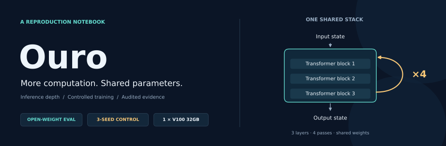
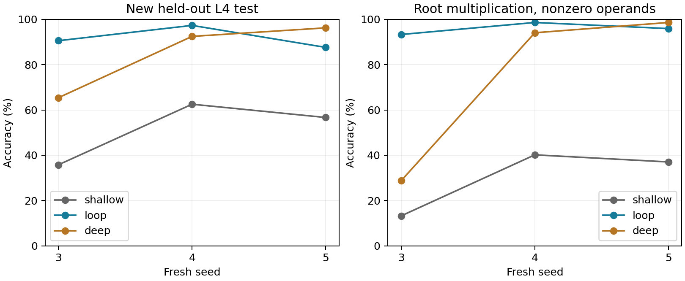
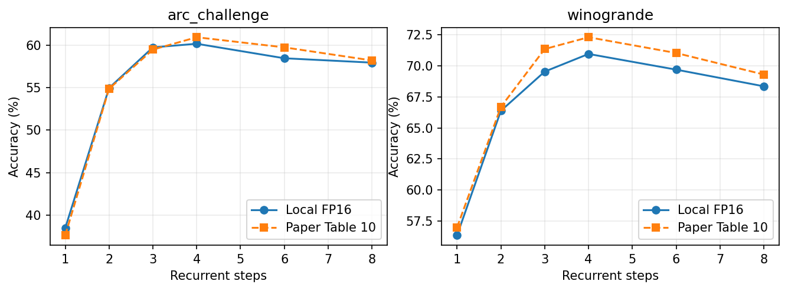
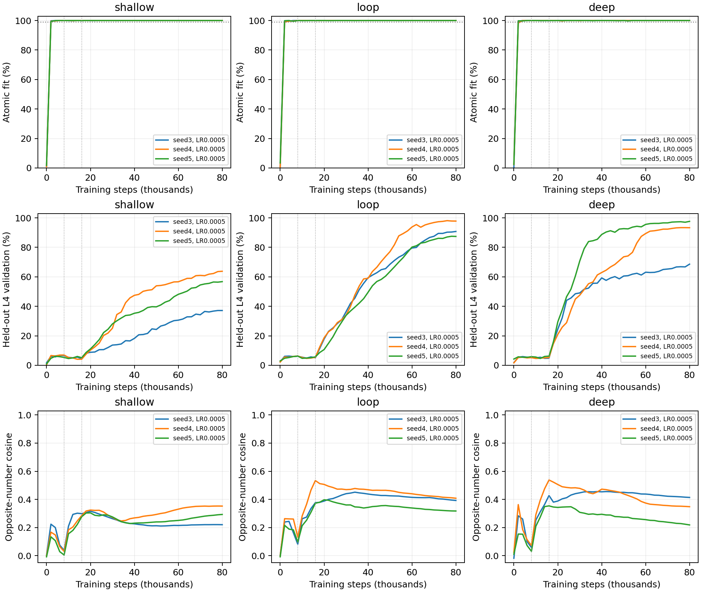

<div align="center">



# Ouro · Minimal Reproduction

**让循环深度的收益，经得起对照与复核。**

[](https://arxiv.org/abs/2510.25741v6)
[](#quickstart)
[](requirements.txt)
[](#resources)

[核心结果](#results) · [问题与修复](#diagnosis) · [实验设计](#protocol) · [快速开始](#quickstart) · [证据索引](#evidence) · [结论边界](#limits)

</div>

---

本项目是论文 **Scaling Latent Reasoning via Looped Language Models** 的独立、非官方复现。围绕两个问题展开：同一个公开模型增加循环次数，表现会怎样变化？从头训练时，共享权重的循环结构能否带来稳定的组合收益？

| 公开权重 · 深度扫描 | 小型 Mano · 三种子确认 | 可靠性 · 独立核验 |
|:---:|:---:|:---:|
| **2 项基准 × 6 个深度** | **Loop 91.78%** | **36 份检查点通过** |
| 四次循环取得最高实测分数 | 相对浅层平均 **+40.13 pp** | 全部正式模型基础运算 **100%** |

> **2026-10-27 更新**：修复基础学习故障后，九组训练均完成固定 80k 步。Loop 在三个新种子上均优于同参数量浅层模型；相对深层模型有种子反例。确认结果来自 **width256、L4 的缩小任务**，不等于完成论文全尺度训练。

<a id="results"></a>

## 01 / 核心结果

### 共享权重，稳定超过同参数量浅层基线

Mano 使用模 23 的前缀算术表达式。这里的 **L4 表示四次运算**，3×4 表示同一组 3 层 Transformer 循环 4 次。每个模型使用新的 10,000 题留出测试集，统一取 80,000 步终点，不挑最佳种子或最佳检查点。

| 模型 | 参数量 | Seed 3 | Seed 4 | Seed 5 | 均值 ± 种子标准差 |
|---|---:|---:|---:|---:|---:|
| Shallow · 3×1 | 2.38M | 35.80% | 62.51% | 56.66% | 51.66 ± 14.04% |
| **Loop · 3×4** | **2.38M** | **90.52%** | **97.26%** | **87.57%** | **91.78 ± 4.97%** |
| Deep · 12×1 | 9.49M | 65.39% | 92.42% | 96.18% | 84.66 ± 16.80% |



Loop−Shallow 分别为 **+54.72、+34.75、+30.91 个百分点**，通过预设的“每种子为正、平均至少 +10 pp”规则。Loop−Deep 则为 +25.13、+4.84、−8.61 pp：**循环模型并非在每个种子上都胜过深层模型。**

[机器可读结果与协议](experiments/ouro-20261027-public-readme/repair-summary.json) · [矢量图 SVG](docs/assets/repair-confirmation.svg)

### 优势集中在哪里？

下表是三个种子的准确率均值。各模型使用相同题目，题数按单个种子计。

| 测试子集 | 题数 | Shallow | Loop | Deep |
|---|---:|---:|---:|---:|
| 根节点为乘法 | 3,388 | 35.87% | **96.24%** | 75.82% |
| 根乘法，两个操作数均非零 | 3,041 | 30.18% | **95.89%** | 73.79% |
| 根乘法，至少一个操作数为零 | 347 | 85.78% | **99.33%** | 93.56% |
| 四个运算全部为乘法 | 131 | 94.66% | **99.49%** | 97.71% |

根乘法上的平均增益为 **+60.37 pp**，比非乘法根节点的增益大 **30.62 pp**，通过预设乘法特异性规则。排除零操作数后优势仍在；纯乘法题则三种模型都很强。差异更多出现在**混合加减乘的组合**，不能概括为“所有乘法题都同样困难”。

将左右子树都替换成正确数值后，九个模型均达到 100%。这与基础运算已经掌握一致，但替换会缩短表达式并可能产生训练见过的题，只能作为定位证据。

### 公开 Ouro-1.4B：循环深度呈先升后降趋势

对同一个 `ByteDance/Ouro-1.4B` **Base** 检查点评估 1、2、3、4、6、8 次循环。下面对照论文 Table 10；单位为百分比。

| 循环次数 | ARC-C · 本地 | ARC-C · 论文 | Winogrande · 本地 | Winogrande · 论文 |
|:---:|---:|---:|---:|---:|
| 1 | 38.48 | 37.63 | 56.35 | 56.99 |
| 2 | 54.95 | 54.86 | 66.38 | 66.69 |
| 3 | 59.73 | 59.47 | 69.53 | 71.35 |
| **4** | **60.15** | **60.92** | **70.96** | **72.30** |
| 6 | 58.45 | 59.73 | 69.69 | 71.03 |
| 8 | 57.94 | 58.19 | 68.35 | 69.30 |



12 个测量点与论文差异均不超过 **1.82 pp**。四次相对一次，ARC-C 提升 21.67 pp，Winogrande 提升 14.60 pp；但四次相对三次的配对区间包含零，不能声称四次显著更好。

<details>
<summary><strong>查看评估协议与配对不确定性</strong></summary>

| 项目 | ARC-Challenge | Winogrande |
|---|---|---|
| 划分与题数 | Test · 1,172 | 有标签 Validation · 1,267 |
| Few-shot | 25-shot | 5-shot |
| 指标 | acc_norm | acc |
| Few-shot seed | 1234 | 1234 |

使用标准 lm-eval 模板，不使用 chat template，不截断提示。模型 FP16，候选项 log-softmax 为 FP32。

| 差值 | ARC-C · 95% 配对区间 | Winogrande · 95% 配对区间 |
|---|---:|---:|
| R4−R1 | +21.67 [18.86, 24.66] | +14.60 [11.37, 17.84] |
| R4−R3 | +0.43 [−0.68, 1.62] | +1.42 [−0.16, 3.00] |
| R8−R4 | −2.22 [−3.58, −0.85] | −2.60 [−4.42, −0.79] |

区间来自逐题配对 bootstrap，重采样 10,000 次，未经多重比较校正；它描述题目采样不确定性，不代表训练种子方差。

扫描复用一次八循环前向的中间状态，六个深度分别与独立截断前向核验。因此扫描总耗时不代表各深度独立推理延迟，也不验证动态退出的加速效果。

[完整评估审查](experiments/ouro-20261026-depth-full/review.md) · [逐项指标](experiments/ouro-20261026-depth-full/depth-report.json) · [配对统计](experiments/ouro-20261026-depth-full/paired-comparisons.json)

</details>

<a id="diagnosis"></a>

## 02 / 从失败到可比较的实验

最初的多种子循环模型曾明显落后。排查发现，一些失败模型把模 23 中的 `a` 与 `−a` 学成近乎相同的表示，完整单步运算表只答对约 **37.6%**。基础数字区分已经丢失，继续增加组合训练步数不足以解释为架构能力差异。

| 排查环节 | 证据 | 后续处理 |
|---|---|---|
| 对照论文 | 旧峰值 LR=0.002，是论文 Mano 搜索上限的 4 倍；warmup 更短 | 优先隔离学习率影响 |
| 单变量控制 | 只降低峰值 LR，两个种子的单步准确率由约 38% 提升到 97.79% / 99.62% | 支持高 LR 是重要促成因素；一个种子仍未过 99% 门槛 |
| 共同配方校准 | 三种架构 × 两个开发种子，固定 8k 均达到单步 100% | 冻结配方后再开正式实验 |
| 新种子确认 | 种子 3/4/5 × 三架构，固定 80k；全部 27 次基础知识检查通过 | 最后统一打开新测试集 |

修复同时调整了学习率、预热、完整衰减日程和课程长度。**正式组合结果不能被解释为仅学习率一个变量的因果效应**，也没有排除初始化或嵌入绑定的影响。

<details>
<summary><strong>查看全部种子的训练与表示曲线</strong></summary>



基础知识门槛检查正常学习，不保证各架构完全收敛或达到最优。浅层模型在后期仍有改善，因此架构差距限于本轮共同配方与固定预算。

</details>

<a id="protocol"></a>

## 03 / 对照如何保持可解释

| 控制项 | 修复后的正式设置 |
|---|---|
| 架构 | Shallow 3×1 / Loop 3×4 / Deep 12×1；width256、4 heads |
| 初始化与数据 | 同种子三架构使用相同训练流；Shallow 与 Loop 初始化相同 |
| 优化 | AdamW；峰值 LR 0.0005；warmup 1,000；余弦降至 0.00005 |
| 课程 | 前 8k 单步 → 8k–16k 最多两步 → 16k–80k 最多四步 |
| 预算 | 每模型 80,000 步、batch256、20.48M 道表达式、FP32 |
| 留出集 | L4 验证 2,048 / L4 测试 10,000 / L2 开发 1,024；全部排除于训练流 |
| 可靠性门槛 | 每模型在 8k、16k、80k 的完整单步表准确率 ≥99%；浅层最终 L4 验证 ≥30% |
| 统计口径 | 保留全部三个新种子；固定终点；预先规定效果规则 |

**执行正确与科学结论分别检查。** 正式实验核验了 36 份检查点、全部 10,000 道测试题的独立算术与结构标签、每模型 278 题 × 4 条件的 CPU 对照，以及全部交叉分组的统计。CPU 抽查共核对 10,008 条正确性记录，不等于在 CPU 上重跑全部测试预测。

<a id="quickstart"></a>

## 04 / 快速开始

**当前公开内容**：公开权重评估、早期小模型训练实现及历史证据可以在本仓库运行；最新 80k 修复实验在本次文档发布中提供[结果摘要、协议与核验信息](experiments/ouro-20261027-public-readme/repair-summary.json)及图表，其训练器、审计脚本和模型检查点尚未包含在此公有版本中。下面的命令对应仓库已有代码。

### 安装环境

使用 Python 3.10 和可用的 NVIDIA CUDA 环境；实测设备为 V100 32GB。

```bash
git clone https://github.com/Flutter-Misdreavus/ouro-minimal-reproduction.git
cd ouro-minimal-reproduction

python3.10 -m venv .venv
source .venv/bin/activate
python -m pip install torch==2.2.2 --index-url https://download.pytorch.org/whl/cu121
python -m pip install -r requirements.txt
python -m pytest tests -q
```

### 运行公开权重的深度扫描

准备脚本会解析上游**运行时的当前版本**。先与已记录版本比较，再下载大文件；版本不同的运行不能直接称为本轮重放。

```bash
python scripts/prepare_ouro.py

python - <<'PY'
import json
from pathlib import Path
expected = json.loads(Path('experiments/ouro-20261026-local-prep/upstream.json').read_text())
actual = json.loads(Path('runtime/upstream.json').read_text())
assert actual == expected, 'Upstream revisions changed; resolve before replaying.'
PY

python scripts/download_weights.py
python scripts/prepare_data.py
python -m ouro_repro.sweep_ouro --smoke --output runtime/shared-depth-smoke
python -m scripts.run_matrix --config configs/depth_shared_full.json
```

运行前保持 Git 工作区干净；修改配置后先提交。输出目录需使用新目录，以保留此前结果。

<details>
<summary><strong>历史小模型实验、环境版本与报告生成</strong></summary>

只运行合成算术任务时，无需下载 Ouro 权重或 ARC/Winogrande 数据。以下重放的是早期 20k 单种子探索，**不对应上方最新 80k 测试分数**。

```bash
python -m ouro_repro.train --config configs/mano_smoke.json --output runtime/mano-smoke
python -m scripts.run_matrix --config configs/atomic_matrix.json
python -m scripts.run_matrix --config configs/recovery_data_matrix.json
python -m scripts.run_matrix --config configs/composition_matrix.json
python -m scripts.verify_composition --directory runtime/composition-s0 --output runtime/composition-verification
```

公开权重扫描完成后，可生成本地报告：

```bash
python scripts/report_results.py --depth-directory runtime/shared-depth-formal/full --output runtime/depth-analysis
```

| 组件 | 已记录版本 |
|---|---|
| PyTorch / CUDA 构建 | 2.2.2 / 12.1 |
| Transformers | 4.55.4 |
| lm-evaluation-harness | 0.4.9.2 |
| Ouro-1.4B revision | `574fa66cb8bf5abdc979642d01cf2b79b16bfab1` |

[完整环境](experiments/ouro-20261026-mano-extended/environment.json) · [上游版本清单](experiments/ouro-20261026-local-prep/upstream.json)

</details>

<a id="evidence"></a>

## 05 / 证据与目录

| 从哪里开始 | 内容 |
|---|---|
| [最新修复实验摘要](experiments/ouro-20261027-public-readme/repair-summary.json) | 三种子分数、四种子树条件、协议、核验范围、实际运行提交与来源哈希 |
| [公开权重评估](experiments/ouro-20261026-depth-full/review.md) | 六个循环深度的分数、对照与统计解释 |
| [首轮训练审查](experiments/ouro-20261026-mano-extended/review.md) | 学习信号不足的原始结果与局限 |
| [早期恢复实验](experiments/ouro-20261026-recovery/review.md) | 11 组诊断、树分布修正与单种子组合实验 |
| [实现与正确性](experiments/ouro-20261026-local-prep/implementation-review.md) | 算术标签、注意力、梯度与保存加载检查 |

```text
configs/        固定配置与顺序运行矩阵
ouro_repro/     循环模型、算术数据、训练与公开权重评分
scripts/        准备、调度、统计与复核工具
tests/          实现正确性检查
experiments/    历史实验记录、最新结果摘要与脱敏证据
docs/           首页封面与结果图表
runtime/        本地数据、权重与运行产物，不进入 Git
```

<a id="resources"></a>

所有实验均在单张 V100 32GB 上运行。公开权重共享前向扫描约 **55 分钟**；九模型正式修复流水线约 **7.60 小时**，包含测试与阶段发布，另有约 **25 分钟**的配方校准。这些是实测墙钟时间，不是独立推理延迟，也不代表最低显存要求。

<a id="limits"></a>

## 06 / 结论边界

- **规模**：小型确认实验为 width256、L4；论文 Mano 为 width1024、L10/16/24，并使用 BF16、打包上下文。相同步数不意味着相同 token 或计算预算。
- **对照**：Loop 与 Shallow 参数量相同，但展开计算更多；与 Deep 展开层数相同，但参数量不同。结果不构成相同 FLOPs 下的优势证明。
- **统计**：三个种子说明本协议下的稳定性，不能替代大规模训练种子统计；基础拟合门槛也不证明最优调参或完全收敛。
- **机制**：子树真值替换用于定位组合困难，不能单凭这些分数证明唯一内部机制。纯乘法子集仅 131 题，需要保留其样本规模边界。
- **覆盖**：没有复现完整 7.7T-token 预训练、全套基准或自适应退出的速度收益。公开模型训练期间曾使用八次循环，超过四次不等于完全未见过的深度。

---

<div align="center">

**每个结论，都有对应的对照、指标与边界。**

[阅读论文](https://arxiv.org/abs/2510.25741v6) · [ByteDance / Ouro-1.4B](https://huggingface.co/ByteDance/Ouro-1.4B) · [lm-evaluation-harness](https://github.com/EleutherAI/lm-evaluation-harness)

</div>
